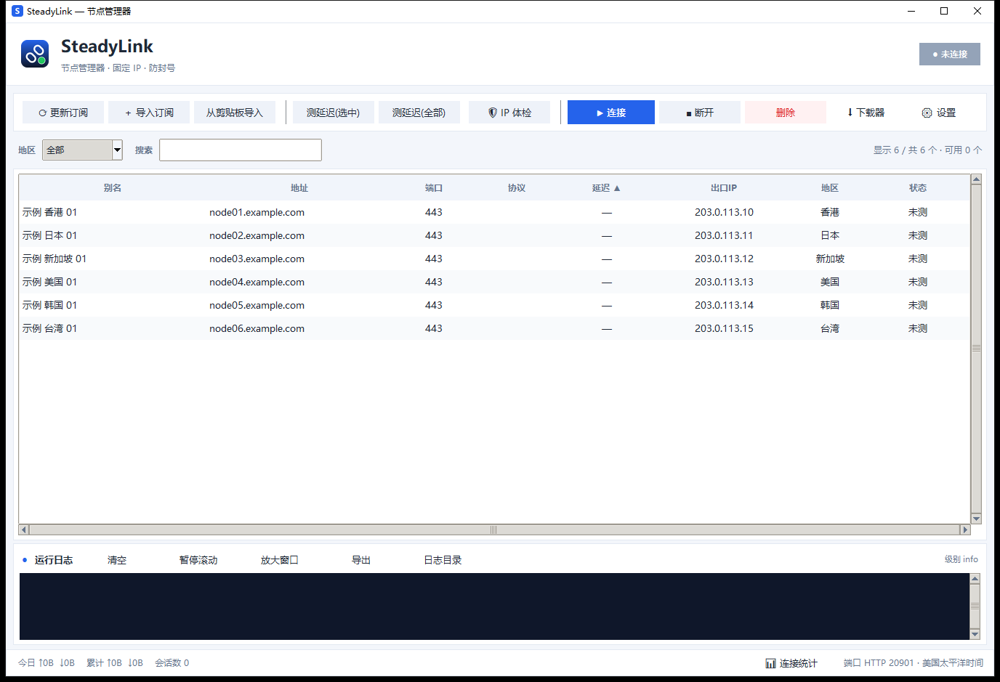
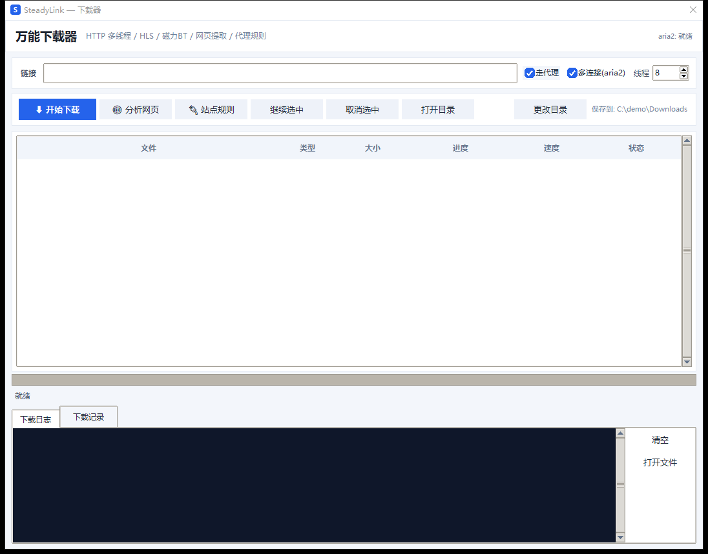
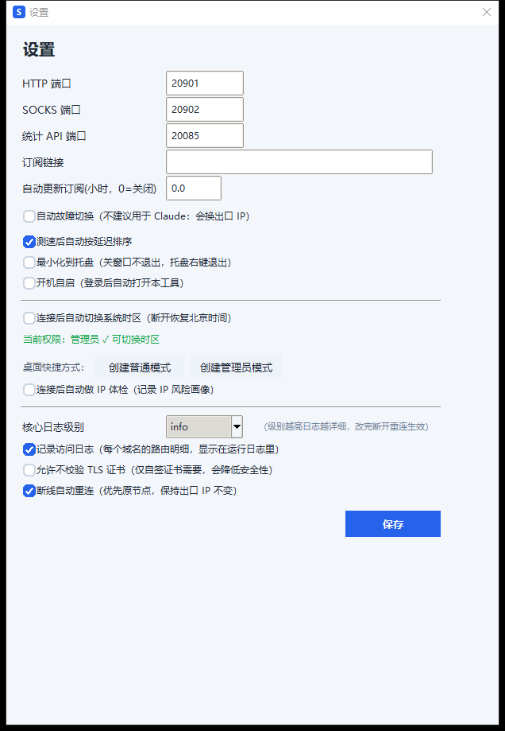
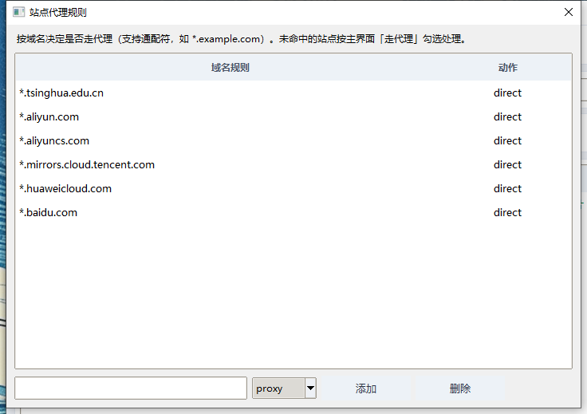
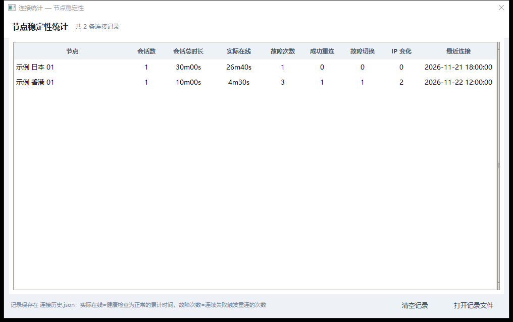

# SteadyLink

> 固定一个 IP，稳定连下去 —— Windows 桌面代理节点管理器 + 万能下载器


**SteadyLink** 是一个 Windows 桌面代理节点管理器（Tkinter GUI + Xray 内核），为「长期固定一个出口 IP、减少账号风控」而设计：订阅管理、真实测速、延迟排序、按国家筛选、出口 IP 监控、时区跟随、IP 风险体检、仿 v2rayN 的实时日志，并且内置一个万能下载器（HTTP 多线程 / HLS / 磁力 BT）。

纯 Python + Tkinter，绿色免安装。

## 截图

| 主界面 + 实时日志 | 万能下载器 |
|---|---|
|  |  |







## 功能

### 节点管理

- **订阅导入 / 更新**：支持 vmess / vless（含 REALITY）/ trojan / shadowsocks 链接，可自动定时更新
- **真实测速**：并发建立 TCP 连接 + 实际握手测延迟，按结果排序，支持 `测延迟(选中)` / `测延迟(全部)`
- **地区筛选 + 搜索**：按国家/地区过滤，按别名、地址、协议搜索
- **固定 IP**：记录每个节点的出口 IP，变化时告警；断线自动重连同一节点
- **IP 体检**：出口 IP 的地理位置、ASN、是否机房 IP、是否被标记为代理，并给风险建议
- **时区跟随**：连接后把系统时区切到节点所在时区，断开自动恢复（需管理员权限）
- **用量统计**：基于 Xray Stats API 统计今日/累计上下行
- **断线自动重连**：监控发现节点掉线后先用原节点重连（保持出口 IP），连续失败且用户开启「自动故障切换」时才换节点
- **连接统计**：区分「会话总时长」与「实际在线时长」（只累计两次检查都正常的区间，断线等待不计），统计故障次数、成功重连、故障切换、IP 变化
- **托盘 & 自启**：最小化到托盘、手动开启开机自启、桌面快捷方式、一键以管理员重启

### 运行日志（仿 v2rayN）

- 实时捕获 Xray 核心 stdout 与访问日志（每个域名走 `direct` 还是 `proxy`）
- 按级别着色（Info / Warning / Error / Debug / 路由直连 / 路由代理）
- 清空、暂停滚动、放大窗口、导出、打开日志目录
- 日志级别可调：`none` / `error` / `warning` / `info` / `debug`

### 万能下载器

| 能力 | 说明 |
|---|---|
| HTTP 多线程 | 自动探测大小，Range 分段并发下载（1–16 线程），支持断点续传 |
| HLS / m3u8 | 自动选最高码率子列表、分片并发、AES-128 解密、合并输出 `.ts`；`EXT-X-BYTERANGE`/`EXT-X-MAP`（fMP4）会明确报“暂不支持”而不是产出坏文件 |
| 磁力 / BT | 内置 aria2c，支持 magnet 与种子文件 |
| 完整性校验 | 分段响应校验、分片长度校验、HLS 解密失败检测 |
| 网页链接提取 | 抓取页面内可下载链接，按扩展名过滤，勾选批量下载 |
| 站点代理规则 | 按域名通配符自动决定「走代理 / 直连」 |
| 任务持久化 | 任务列表保存到 `dl_tasks.json`，重启自动恢复，中断可续传 |
| 下载日志 / 记录 | 独立 `download.log` 与 `dl_history.json`，界面内可查 |

## 快速开始

### 1. 环境

- Windows 10 / 11
- Python 3.10+（安装时勾选 `tcl/tk`，官方安装包默认包含）

### 2. 安装依赖

```bash
python -m pip install -r requirements.txt
```

### 3. 准备内核

```bash
python scripts/setup_bin.py
```

脚本会把 **Xray-core** 与 **aria2** 下载到 `bin/`（也可手动下载后放到 `bin/xray.exe`、`bin/aria2/aria2c.exe`）。

### 4. 启动

```bash
python steadylink.py
```

或者双击：

- `SteadyLink.cmd` —— 普通模式
- `SteadyLink-Admin.cmd` —— 管理员模式（时区跟随、系统代理需要）

### 5. 导入节点

工具栏「导入订阅」粘贴机场订阅链接，或「从剪贴板导入」粘贴节点链接，然后选中节点点「连接」。

## 下载速度与稳定性

- 进度按磁盘实际写入字节统计（不再等分片完成才跳一次），速度/进度更平滑；
- 默认多连接（aria2，16 连接）抗抖动，可取消勾选改用 curl 分段；
- 慢速连接会自动中止并重试（`--speed-limit`），避免某一段卡住拖垮整体；
- 速度仍受节点质量影响：可在下载器里对比「走代理」与直连，或换一个延迟更低的节点。

## 测试

关键路径的故障注入测试（无需外网，下载/HLS 用本地 HTTP 服务器）：

```bash
python tests/run_tests.py -v
```

覆盖：核心启动令牌（过期线程不误杀新进程）、自动重连并发/停止、系统代理备份与恢复、在线时长口径、HTTP 分段校验与回退、If-Range/ETag 变化检测、HLS AES-128/错误密钥/不支持加密、续传资源身份（URL/大小/ETag/密钥内容/IV/BYTERANGE/MAP 参与的 HLS 摘要）、断网续传回退。共 42 个用例。

详见 [tests/README.md](tests/README.md)。

## 目录结构

```
SteadyLink/
├── steadylink.py          # GUI 主程序
├── v2core.py              # Xray 配置生成 / 核心管理 / 测速 / 时区 / IP 体检
├── downloader.py          # 下载引擎（HTTP / HLS / BT / 规则 / 持久化）
├── assets/                # 图标（窗口 / 托盘 / 快捷方式）
├── bin/                   # Xray 与 aria2c（不入库，由 setup_bin.py 下载）
├── scripts/setup_bin.py   # 一键下载内核
├── docs/screenshots/      # 截图
├── tests/                 # 故障注入测试（python tests/run_tests.py）
├── config.example.json    # 配置样例
├── nodes.example.json     # 节点样例
└── 使用说明.md             # 详细中文说明
```

## 配置

首次运行会在程序目录生成 `config.json`（**包含你的订阅链接，请勿提交到仓库**）：

| 字段 | 说明 |
|---|---|
| `http_port` / `socks_port` | 本地 HTTP / SOCKS 监听端口 |
| `stats_port` | Xray Stats API 端口（用量统计） |
| `subscription` | 机场订阅链接 |
| `auto_update_hours` | 订阅自动更新间隔（0 = 关闭） |
| `auto_failover` | 自动故障切换（注意：会更换出口 IP） |
| `tz_follow` | 连接后自动切换时区 |
| `auto_reconnect` | 断线自动重连（默认开启，优先原节点） |
| `allow_insecure` | 允许不校验证书（默认关闭，仅自签证书需要） |
| `core_log_level` | 核心日志级别 |
| `access_log` | 是否记录访问日志（路由明细） |

## 常见问题

**Q：连接后系统时间变了？**
开启了「时区跟随」，这是有意为之；断开或关闭该选项会自动恢复为北京时间。

**Q：提示需要管理员权限？**
切换系统时区、设置系统代理需要管理员；用 `SteadyLink-Admin.cmd` 启动即可。

**Q：下载器提示 403 或大小未知？**
部分站点会拦截非浏览器请求或忽略 Range 请求，下载器会自动回退为单流下载；可尝试换直链。

**Q：磁力/BT 下载很慢或没有速度？**
BT 依赖 UDP/DHT，无法通过 HTTP 代理转发，建议直连或使用 TUN 模式；同时需要公网可连的 tracker。

**Q：日志里 `[Info] ... accepted //xxx [http-in >> proxy]` 是什么？**
Xray 的访问日志：域名命中代理规则走 `proxy`，否则走 `direct`。

## 安全性说明

- **TLS 证书校验默认开启**：Trojan / TLS 节点默认校验证书，只有手动开启「允许不校验证书」才会跳过；
- **系统代理可还原**：连接前会备份 Windows 代理的完整状态（启用状态、代理地址、绕过列表、PAC 脚本），断开或退出时恢复原值，异常退出会在下次启动时自动修复；
- **下载完整性校验**：HTTP 分段会校验 206 状态码与 `Content-Range`，分片大小不符会回退单流或报错；HLS 解密失败会明确报错而不是输出损坏文件；
- **续传身份校验**：断点分片会记录 URL / 文件大小 / 分片参数，资源不匹配时自动丢弃旧分片，避免把别的文件拼进来；
- **代理接管保护**：备份会校验结构完整性，损坏/缺字段的备份会被拒绝接管；写入异常自动回滚；连接后若系统代理未生效，状态栏会明确标注；
- **连接操作令牌**：每次启动核心都会分配 token，过期的重连线程只能停止自己启动的进程，不会误杀新连接；
- **续传身份**：HTTP 续传记录 ETag / Last-Modified（分片请求带 `If-Range` 并校验响应 ETag），HLS 记录分片序列 + 密钥 URI/IV + 密钥内容 SHA-256 + 初始化段摘要；身份不一致一律重新下载；
- **错误响应不落盘**：单流下载使用 `curl -f`，HTTP 4xx/5xx 会判定失败，不会把错误页当成文件。

## 安全与隐私

- 节点信息、订阅链接、下载记录**只保存在本机**，程序不会上传任何数据；
- 仓库中不包含任何节点、订阅或二进制内核；
- `.gitignore` 已排除 `config.json`、`nodes.json`、`runtime/`、`bin/`、下载记录等敏感文件。

## 免责声明

本项目仅供学习与个人网络调试使用。请遵守你所在地区的法律法规以及所使用服务商的条款，勿用于商业转售或任何非法用途。使用本工具产生的后果由使用者自行承担。

## 许可

本项目代码采用 [MIT License](LICENSE)。

第三方组件：Xray-core（MPL-2.0）、aria2（GPLv2）、pycryptodome（BSD）、pystray（LGPL）、Pillow（MIT-CMU），详见 [THIRD_PARTY.md](THIRD_PARTY.md)。仓库不附带上述二进制，`scripts/setup_bin.py` 会在本地下载。

---

## English

**SteadyLink** is a Windows desktop proxy node manager built with Tkinter and the Xray core. It is designed for people who need a stable, pinned egress IP: subscription management, real latency tests, region filtering, egress IP monitoring, timezone following, IP reputation checks, and v2rayN-style live logs.

It also ships a universal downloader: multi-threaded HTTP with resume, HLS/m3u8 (AES-128), BitTorrent via aria2, web page link extraction, per-site proxy rules, and persistent download tasks/history.
